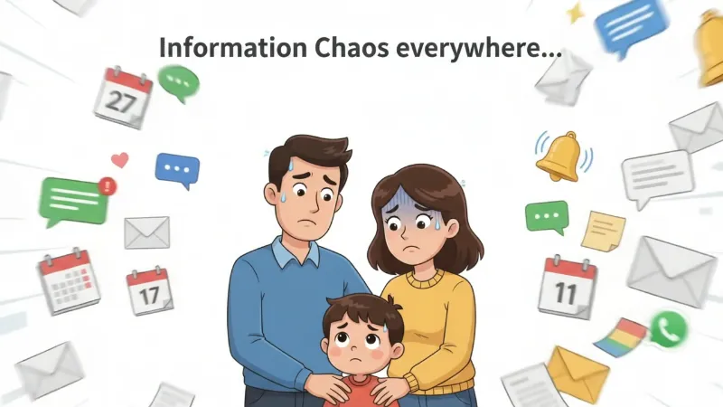
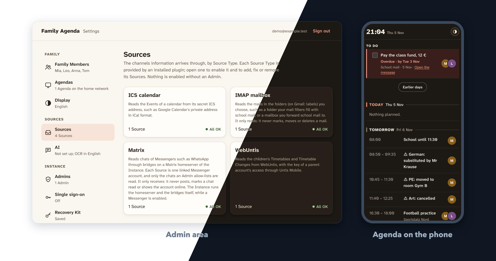
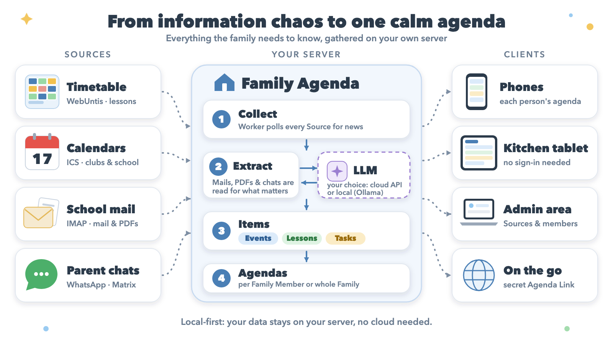

<div align="center">

# 🏠 Family Agenda

**Who has to be where, when, with what, in one calm overview.**

Self-hosted · Local-first · No cloud needed

[](LICENSE)




</div>

---

## ✨ What it does

School timetables, club calendars, school mails with PDF attachments, parent chats: the family's information is scattered everywhere. Family Agenda collects it all and shows **one agenda per family member**, on your own server.

| | Source | How it is read |
|---|---|---|
| 🎓 | **School timetable** | WebUntis: lessons, substitutions, room changes |
| 📅 | **Calendars** | ICS feeds: clubs, school, holidays |
| ✉️ | **School mail** | IMAP, including PDF attachments (OCR) |
| 💬 | **Parent chats** | WhatsApp and other Messengers via Matrix bridge |

## 📸 See it



## 🔍 How it works



1. **Collect**: a worker polls every Source and keeps each Source Record it delivers.
2. **Extract**: mails, PDFs and chat messages are read once by an LLM (any OpenAI-compatible endpoint, cloud or local) to find what matters. Calendars and timetables are structured already and skip this step.
3. **Items**: findings become **Events**, **Lessons** and **Tasks**, each attributed to the Family Members it concerns.
4. **Agendas**: one per Family Member, or one for the whole Family, as a timeline of days or a Task List.

Agendas open without signing in on the home network (kitchen tablet, phones). Away from home, a secret, revocable **Agenda Link** opens a single Agenda. Sources, members and agendas are managed in the Admin area.

## 🚀 Install & start

Requires Docker with Compose. The Instance runs a published image for `amd64` and `arm64`, so nothing is built on your machine.

```sh
mkdir family-agenda && cd family-agenda
curl -fsSLO https://github.com/artkoenig/family-agenda/releases/latest/download/compose.yaml
docker compose up -d
```

Open `http://localhost:8080`, create the first Admin, keep the **Recovery Kit** safe. Then add Family Members, Agendas and Sources in the Admin area.

An Instance runs the release its `compose.yaml` comes from. To move to another release, back up first and follow [docs/upgrading.md](docs/upgrading.md). Running it in Portainer: [docs/portainer.md](docs/portainer.md).

> [!NOTE]
> Releases before 1.0.0 may ask you to start over instead of keeping your data. Every GitHub Release says which in its **Upgrading** section, and [docs/upgrading.md](docs/upgrading.md#start-over) says how to start over.

### Build from source

To run your own changes, build the image from a clone:

```sh
git clone https://github.com/artkoenig/family-agenda.git
cd family-agenda
docker compose -f compose.yaml -f compose.dev.yaml up -d --build
```

## ⚙️ Configuration

Container variables, the address the Family opens, HTTPS behind a proxy and single sign-on for Admins: see [docs/configuration.md](docs/configuration.md).

## 🧪 Trying a pull request

`pnpm preview up <pr>` runs a pull request's code with demo data before it is merged: see [docs/preview.md](docs/preview.md).

## 🖥️ Hardware

| | Needs |
|---|---|
| **Host** | 64-bit, always on, running Docker: Raspberry Pi, NAS, mini PC or server. Linux needed for `family-agenda.local` (mDNS). |
| **RAM** | ~2 GB for api, worker, Postgres; +0.5 GB with Messengers enabled (Synapse + bridge). |
| **Disk** | A few GB for image and data; more for mail attachments. |
| **LLM** | Any OpenAI-compatible endpoint. Cloud API (no extra hardware) or local, e.g. Ollama with a 9B model on 8-12 GB VRAM. |

## 📄 License

AGPLv3, see [LICENSE](LICENSE).
